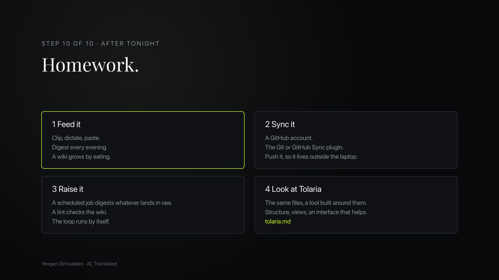

# Homework

Four jobs for the weeks after the workshop. Do them in order: a wiki you do not feed has nothing to sync, and a loop you do not trust has nothing to raise.

- [ ] [1 Feed it](1-feed-it.md): clip, dictate, paste. Digest every evening. A wiki grows by eating.
- [ ] [2 Sync it](2-sync-it.md): a GitHub account, the Git plugin, push it, so it lives outside the laptop.
- [ ] [3 Raise it](3-raise-it.md): a scheduled job digests whatever lands in `raw/`, a lint checks the wiki, the loop runs by itself.
- [ ] [4 Look at Tolaria](4-look-at-tolaria.md): the same files, a tool built around them.

Each page is a checklist. Tick a box in Obsidian when the step is done. Lines in quotes are what you type, or dictate, into the agent chat.

Stuck? Ask the agent: "Read `homework/README.md` and help me with the next open step."
